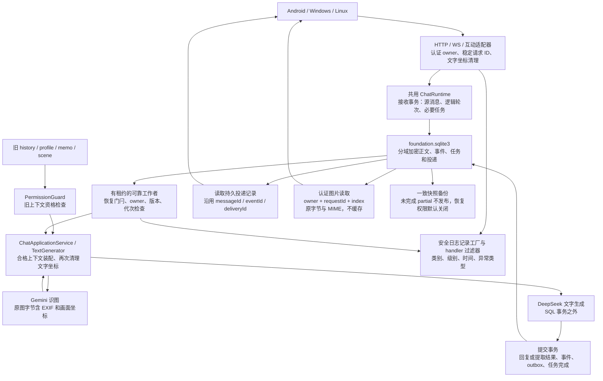

# 阶段 A 数据流、加密域与副本边界

日期：2026-10-16（北京时间）。本文件依据当前工作树静态审阅及合成测试入口记录实现事实，不证明生产或三端设备已完成迁移、运行验收。三端客户端随后已加入跨设备历史原图恢复代码（未打包、未上机，见末节）。

## 服务数据流

入口和装配见 `Taki_Shiina_Bot/unified_api.py`、`services/chat_runtime.py`、`services/text_generation.py`。事务实现见 `services/foundation_store.py` 与 `services/reliable_chat_store.py`。图中投递表示持久结果的重试路径；外部接收方仍需按稳定 ID 去重，不能据此宣称网络 exactly-once 或三端通知已经实机验证。

`FOUNDATION_ENABLED=1` 可在隔离目录启用新 SQL 链路；同一数据目录已经存在 `foundation.sqlite3` 后，关闭该业务开关不能切回旧 JSON 链路绕过权限。首次启用不会自动导入旧历史和画像。当前 SQL 存在时，旧 `bot.py` Telegram 入口在旧仓储和模型客户端初始化之前明确拒绝启动，提示改用 `unified_api`。

## 加密与元数据清单

`services/domain_cipher.py` 使用 HKDF 为各域及索引分别派生密钥，正文使用 AES-GCM；每次加密生成随机 12 字节 nonce，封装包含版本与 key ID。AAD 绑定格式版本、key ID、域、owner 索引及实体身份；事实调用还把修订纳入身份。身份由认证适配器和服务端装配，模型不能提供可信 owner。

| 数据 | 当前保护 | 实现边界 |
|---|---|---|
| 源请求、用户输入、已提交聊天行 | `source_message` 域加密，存入 `requests` / `chat_messages`；图片原字节以规范 base64 存在源请求加密正文内 | 恢复后读取同一原图发给 Gemini；历史只含下载所需 `requestId/imageCount`，认证端点按 owner 取回原字节 |
| 用户事实、角色日常、官方资料 | `user_fact` / `character_daily` / `official_lore` 域 | 有通用事实仓储接口；不表示阶段 B～D 的完整业务已交付 |
| 证据 | `evidence` 加密域已定义，DomainCipher 可加解密 | 尚无独立证据业务仓储/生产链，不能把域枚举当作证据业务已落地 |
| 逻辑轮次、合并来源、结果、owner 映射、恢复标记 | `derived` 域 | 未建立新的持久明文摘要或画像索引 |
| 任务输入、依赖、结果及运行错误类别 | `job` 域 | 队列状态、租约等调度字段仍可见 |
| 数据变更正文与投递目标/载荷 | `event` / `delivery` 域 | 事件顺序和稳定投递关联 ID 可见 |
| owner、请求 ID、客户端消息 ID、任务幂等索引 | 独立索引密钥 HMAC | 不将原始身份或业务幂等文本作为这些 SQL 索引明文保存 |
| ID、域名、事实修订、事件顺序、状态、次数、时间、租约 token | SQL 明文运行元数据 | 可暴露活动形态，数据库及备份仍属于受限数据，不能公开 |
| 检索 | 分批读取密文，在内存解密并做子串匹配 | 后端 SQL 原型没有明文关键词索引；不等同于语义检索召回验收 |
| 旧 JSON 文件 | `SecureJsonStore` 的 AES-GCM 文件封装；读写时清理支持的坐标形式 | 与 SQL 分域方案不同；旧 JSON 不因引入 SQL 自动完成分域迁移 |
| 根密钥及配置 | 从运行环境读取，不写入上述 SQL 正文/文档/日志 | `.env`、环境配置、密钥保管与主机权限并未因此自动加密；未在本轮读取或复制生产密钥 |

模型调用与外部投递不持有数据库写事务。事实变更与事件/outbox、提取结果与任务完成、最终回复与所需事件/outbox在各自 SQL 提交边界一起成功；旧积分文件与 SQL 的协调仍按相应适配代码及专门故障回放验证，不能把此表理解为任意跨文件事务保证。

## 权限与恢复

`services/permission_guard.py` 在发现同目录 SQL 后调用 `ReliableChatStore.owner_context_allowed(owner)`。空库、外来损坏库、错误密钥、已观察到的库丢失和未验证恢复不会降级成“无旧上下文”的成功结果；恢复门闩错误向上抛出。业务开关不能关闭该检查。

| 路径 | 当前保守处理 |
|---|---|
| 旧 history 与 SQL 模型历史 | owner 任一事实禁用后，无法映射来源的旧历史整体隔离；`history(for_model=True)` 返回空历史。显示/审计历史不等于模型可用历史 |
| profile / memo / 固定用户名 | `MemoryService.get_profile`、`PromptService.get_system_prompt` 检查同一门禁；不装配旧画像、备忘及固定 Kris 名称，不允许旧画像更新重新写回 |
| scene / cache | 禁用后不读取、生成或刷新该 owner 的旧场景上下文，并移除相应场景缓存；生成完成前再检查权限，恢复错误不以旧缓存兜底 |
| 共用上下文 | `ChatApplicationService.legacy_allowed` 告知调用者资格；适配器和生成器据此隔离旧历史。当前逻辑轮次输入仍可使用，普通文字聊天不因单个禁用事实整体停用 |
| 提取与依赖任务 | 禁用 owner 的旧来源提取被取消或跳过，提交时再次检查；显式 `FactRef` 依赖在领取/完成时核对 owner、enabled 和修订；生成还受权限序号、代次、截止时间检查 |
| 全局恢复关闭 | 模型上下文与业务读写显式拒绝，工作者不领取任务；这与某 owner 的旧上下文隔离是不同范围 |

这是缺少旧内容逐条来源映射时的整体隔离策略，并未实现阶段 B 的全部事实资格、时间语义及派生关系。禁用/恢复事件仍需同步，不能把“隔离旧模型上下文”解释为删除存量或停止所有同步。

`FoundationStore.backup` 使用 SQLite 一致快照，把副本的 `permissions_ready` 设为 false；完成前为不可打开的 `.partial` 文件，完成后以不覆盖已有目标的方式发布。`mark_restored` 保持恢复关闭，只有 `verify_restored_permissions` 对照受信最新变更序号成功后才能解锁。该最新序号必须来自恢复集之外的可信信息，不能让旧备份用自己的旧序号自证最新。本轮没有部署独立的生产权限水位保管服务，也没有完成生产密钥/备用服务器恢复演练。

## 坐标、图片与日志出口

`services/privacy.py` 对支持的结构化经纬度/GPS 字段、十进制/科学计数坐标对、度分秒、方向标记和已识别地图 URL 清理；递归处理 JSON 值、Unicode/十六进制转义、URL 百分号和 HTML 实体，支持最多 8 层。非法 Unicode/UTF-8 或解码超限明确失败。输入、上下文装配、加密前以及解密后的相关入口调用同一工具；天气城市配置拒绝识别到的详细坐标，既有此类城市值读为 `auto_ip`。

这些规则不识别任意 base64/加密二进制、地名推断、图片像素中的文字或 OCR 语义。用户后续明确允许图片的 EXIF 和画面坐标原样保留并发给模型，构成 PRD-01 FND-10 的限定例外。WS 图片经格式、张数及大小验证后，将原字节保存在加密的源请求中；清理器跳过经摘要验证的图片 base64 字段，以免把偶然形似坐标的编码字符改坏。任务与投递只存引用和图片数量，重启后从源请求恢复原图交给 Gemini。Gemini 的文字描述进入 DeepSeek 前仍受文字坐标清理。认证图片读取端点按 owner 与 requestId 隔离并返回原图，不允许中间缓存；三端历史补拉可据此恢复本地附件。HTTP 聊天输入接口仍仅处理文字。既有 `strip_image_metadata` 工具未用于此路径，因此不会剥离 EXIF。客户端附件与系统备份的实际存储策略仍需在部署时核对。

`services/privacy_logging.py` 为已有 root/第三方输出 handler 安装过滤器，并通过安全记录工厂保护后来 handler 的标准字段。正文、格式化参数、异常正文、堆栈和任意额外字段在受保护 handler 中不输出；只保留安全事件类别、级别、时间及异常类型。Uvicorn `AccessFormatter` 依赖原始 5 个 HTTP 参数，安装时改用普通安全事件 formatter，原 URI 和参数不恢复。后来新增的自定义结构化 handler 仍须安装过滤器或再次调用安装器；不能仅靠记录工厂保护日志系统在工厂之后追加的任意 `extra` 字段。

## 客户端副本：本次静态核验

以下结论针对应用代码中的本地存储路径；没有检查实际设备文件、系统全盘加密、Keystore/DPAPI/密钥环状态，亦没有重新执行三端安装和运行验收。凭据加密不能代表聊天数据库已加密。

| 客户端 | 业务副本代码证据 | 凭据与附件证据 | 本次结论 |
|---|---|---|---|
| Android | [DatabaseModule.kt](../TKS_Bot_Android/core/database/src/main/java/com/krisslin/androidaiassistant/core/database/di/DatabaseModule.kt) 直接 `Room.databaseBuilder(..., "android_ai_assistant.db")`；[ChatMessageEntity.kt](../TKS_Bot_Android/core/database/src/main/java/com/krisslin/androidaiassistant/core/database/entity/ChatMessageEntity.kt) 为 `content: String`，DAO 直接更新正文；该数据库模块未配置 SQLCipher 或字段加密适配 | [TokenManager.kt](../TKS_Bot_Android/core/network/src/main/java/com/krisslin/androidaiassistant/core/network/auth/TokenManager.kt) 使用 EncryptedSharedPreferences（AES256-SIV/GCM）；[ChatImageAttachmentManager.kt](../TKS_Bot_Android/feature/chat/src/main/java/com/krisslin/androidaiassistant/feature/chat/ChatImageAttachmentManager.kt) 将图片复制到应用私有 `chat_attachments` 文件 | 聊天/事实副本没有在已审阅路径中获得应用层加密；凭据有加密实现；应用私有目录不等同于业务内容加密 |
| Windows | [LocalDb.cs](../TKS_Bot_Windows/TKSDesktop/Core/Data/LocalDb.cs) 使用普通 `Microsoft.Data.Sqlite` 连接；[MessageRepository.cs](../TKS_Bot_Windows/TKSDesktop/Core/Data/Repositories/MessageRepository.cs) 将 `message.Content` 直接作为 SQL 参数；[DatabaseSchema.cs](../TKS_Bot_Windows/TKSDesktop/Core/Data/DatabaseSchema.cs) 的正文列及 FTS5/trigram 索引保留可搜索正文 | [ThemeAwareSecretStore.cs](../TKS_Bot_Windows/TKSDesktop/Platform/Windows/ThemeAwareSecretStore.cs) 用 CurrentUser DPAPI 保存凭据，不提供明文降级；[MediaService.cs](../TKS_Bot_Windows/TKSDesktop/Core/Services/Media/MediaService.cs) 与平台适配器将附件字节保存到附件目录 | 聊天/事实库及其正文索引没有在已审阅路径中获得应用层加密；DPAPI 覆盖凭据，不覆盖普通 SQLite 和附件 |
| Linux | [db.ts](../TKS_Bot_Linux/src/main/core/database/db.ts) 使用 `new Database(dbPath)`（better-sqlite3），正文 `TEXT` 列及 FTS5/trigram 索引；[message-repository.ts](../TKS_Bot_Linux/src/main/core/database/repositories/message-repository.ts) 直接写入 `input.content` | [token-manager.ts](../TKS_Bot_Linux/src/main/core/auth/token-manager.ts) 优先 Electron safeStorage；无密钥环且 `allowPlaintextCredentials=true` 时存在 0600 明文凭据分支（默认配置 false）；[image-service.ts](../TKS_Bot_Linux/src/main/core/chat/image-service.ts) 写入附件 PNG | 聊天/事实库、索引及附件没有在已审阅路径中获得应用层加密；凭据是否加密取决于运行模式，未在设备上验证 |

跨设备历史原图恢复已在本轮之后的客户端代码中实现：`ChatApi.kt`、`rest-client.ts`、`RestClient.cs` 调用认证图片下载接口，按 `requestId/imageCount` 恢复本地附件；Android 另有 `HistoryImageRestorePolicy.kt` 与单测，Windows 另有 `HistoryImageDownloadTests.cs`。这些改动**未打包、未签名、未在真机或预发后端运行**；Windows 客户端静态门禁当前有 2 项失败（冻结 DTO 字段映射未登记 `requestId`/`imageCount`/`clientMessageId`；`ChatService.cs:479`、`SyncService.cs:422`、`MessageItemViewModel.cs:130` 硬编码 `[图片]`）。Android 模块单测与 Linux 类型检查通过，但不代表客户端副本的加密保护已完成：三端聊天数据库与附件仍没有应用层加密。

三端既有 WAL、SHM、数据库恢复备份、搜索索引、附件与主动导出也属于敏感副本审阅范围；本轮没有清理或迁移它们。操作系统可能提供设备加密，但不能凭静态代码宣称实际开启或满足本 PRD 的应用保护要求。

## 验证与适用范围

后端合成验证入口包括 `test_privacy_boundaries.py`、`test_permission_guard.py`、`test_foundation_store.py`、`test_reliable_chat_store.py`、`test_durable_worker.py` 及入口集成测试。真实 Uvicorn formatter 的坐标/秘密 URI 探针已加入日志回归。这里不复制可能随工作树继续变化的全量通过数；以本轮验证记录为准。

**旧历史存量、既有日志、备份、配置和设备副本未自动清理。** 新 SQL 链路、合成恢复及坐标探针通过，不能证明历史数据已全部净化，也不能替代迁移映射、生产实际版本、停写窗口、权限水位、三端运行与恢复验收。禁止把隔离环境结论未经生产迁移与核验直接套用到现网，或据此宣告全面加密及生产发布完成。
